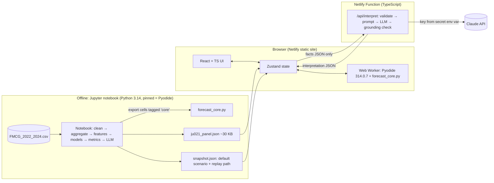

# Phase 2 — Dataset Inspection & Implementation Plan

**Exercise:** AI in Operations, Session II lab, slide 64: *Forecasting Monthly Sales for a New Beverage Product*.
**Status:** plan only. No development code exists yet; it waits for "Plan approved, begin development".
**Date:** 12 Nov 2026.

---

## 0. Decisions at a glance

| Topic | Decision |
|---|---|
| Product series | SKU **JU-021**, the dataset's only beverage. It stands in for the new flavored water. It launched on 11 Jul 2022 and sells in 3 regions × 3 channels |
| "First year" | The first 12 full months, **Aug 2022 – Jul 2023**. July 2022 is a partial launch month (21 days) and is excluded from modelling |
| Default split | Chronological: **train 9 months (Aug 2022 – Apr 2023), test 3 months (May – Jul 2023)** |
| Forecast | **Next 3 months.** Each model is refit on all available months before forecasting |
| Models | **Naive · Seasonal Naive · ARIMA · Random Forest · XGBoost.** All use the same target, split, horizon and metric code |
| Metrics | **MAPE and WAPE** with explicit formulas and zero handling, cross-checked by hand. Bias is a supporting diagnostic |
| "Real-time data" | The 17 held-back months (Aug 2023 – Dec 2024) arrive as a live monthly feed. Users can also add, edit or upload months. Every change retrains all models and regenerates the LLM interpretation |
| Where models run | **In the browser:** the same Python code as the notebook, running in Pyodide in a Web Worker |
| Where the LLM runs | **A Netlify Function** (TypeScript). The API key lives only in a secret env var |
| LLM provider | **Anthropic Claude** by default (`claude-opus-5-5`; the model can be changed via an env var). The provider sits behind an adapter, so Gemini can replace it if you prefer, and a rule-based fallback is always available. **This needs your confirmation** |
| Precomputed | Only a **snapshot** of the default scenario and the default replay path, exported by the notebook. It gives an instant first view and serves as the parity reference. Everything else is computed live |

---

## 1. Dataset inspection report

**Files received in `Dataset/`.**

| File | Use |
|---|---|
| `FMCG_2022_2024.csv` (17.7 MB, 190,757 rows × 14 columns) | **Primary source** |
| `batch_MI-006_2025-01-*.parquet` (4 files), `df_weekly_MI-006_enriched.csv`, `weekly_df_final_for_modeling.csv` | The author's derived files: weekly batches and features for SKU MI-006 (milk) and engineered weekly features. **Not used** |

**Structure.**
- **Columns:** `date, sku, brand, segment, category, channel, region, pack_type, price_unit, promotion_flag, delivery_days, stock_available, delivered_qty, units_sold`.
- **Dates:** 21 Jan 2022 → 31 Dec 2024 (1,076 days).
- **Coverage:** 30 SKUs in 5 categories (Yogurt, Milk, ReadyMeal, SnackBar, Juice), 3 regions (PL-North/Central/South), 3 channels (Retail/Discount/E-commerce).
- **Launches:** SKUs launch at staggered dates through 2022–2023. Each SKU is present every day from its launch to the end of the data.

**Quality checks.**

| Check | Result | Action |
|---|---|---|
| Missing values | 0 in every column | — |
| Duplicate `(date, sku, channel, region)` keys | 0 | — |
| Negative values | 3 rows with negative `units_sold`; negative `stock_available` (min −12) and `delivered_qty` (min −11) elsewhere. **None in JU-021** | Documented. No action needed for our scope |
| Stockouts | `units_sold = 0` exactly when `stock_available = 0` (3,860 rows overall). **JU-021: 150 rows (2.2%)** | Sales during stockouts are understated demand. The effect is small at monthly level. Reported as lost-sales context for recommendations |
| Missing rows | JU-021 has on average 7.7 of 9 region × channel rows per day. Each series is active on 741–796 of 905 days | A missing row means no recorded sale. Monthly sums handle this, and it is noted as noise |
| `price_unit` | Uniform 1.5–9 for every category, uncorrelated with units (r = −0.001) | **Excluded:** it is simulation noise |
| `pack_type`, `delivery_days` | Uniformly random (about one third each; 1–5 days evenly) | **Excluded** |
| `promotion_flag` | Real effect: JU-021 sells 30.4 units per row with promotion vs 15.7 without (×1.94). Monthly promo share varies only between 9% and 19% | Used for **interpretation and recommendations**, not as a model input: the future promotion calendar is unknown, and the monthly signal is weak |
| Partial launch month | July 2022 has 21 days of sales | Excluded from modelling; shown in EDA |
| Days in month | The February 2023 dip is partly calendar: 117 units/day vs 134 in January | `days_in_month` becomes a feature for the ML models |

**JU-021 monthly units.** These are totals across 3 regions × 3 channels; the 9 series range from 207 to 746 units per month, with **no zero months**.

| | Jan | Feb | Mar | Apr | May | Jun | Jul | Aug | Sep | Oct | Nov | Dec |
|---|---|---|---|---|---|---|---|---|---|---|---|---|
| 2022 | | | | | | | *3,469 (partial)* | 4,510 | 5,464 | 4,988 | 4,512 | 4,364 |
| 2023 | 4,156 | 3,285 | 4,781 | 4,961 | 5,541 | **6,072** | 5,661 | 4,607 | 3,687 | 3,512 | 2,842 | 2,615 |
| 2024 | 2,799 | 2,871 | 3,957 | 3,844 | 4,635 | 5,118 | 5,316 | 4,338 | 3,599 | 3,431 | 2,818 | 2,596 |

What the series shows:
- **Lifecycle:** launch growth to September 2022, a winter trough, the first summer peak (June 2023), then a maturity reset in which 2024 runs about 16% below 2023 in summer. The year-on-year gap narrows to −1% to −2% by Sep–Dec 2024.
- **Seasonality:** strongly summer-peaking. Juice's calendar index is 1.32 in June and 0.76 in December.
- **Regions and channels:** all three regions and channels move together, each with roughly a one-third share. Region-level forecasting is feasible.

**Model feasibility probe.** This was a throwaway check; the final numbers come from the notebook in Phase 3.

| Scenario | Naive | Seasonal Naive | ARIMA (auto) | RF (pooled) | XGB (pooled) |
|---|---|---|---|---|---|
| First year: train 9, test May–Jul 2023 (WAPE) | **13.8%** | n/a (fewer than 12 months) | 13.8% (chose a random walk) | 20.4% | 22.5% |
| Train 12, test Aug–Oct 2023 | 43.9% | **28.4%** | 43.9% | 36.2% | 47.8% |
| Train 21, test May–Jul 2024 | 23.5% | 14.6% | 23.5% | 19.3% | **12.1%** |
| Train 26, test Oct–Dec 2024 | 22.1% | **1.4%** | 1.6% (SARIMA) | 4.1% | 4.7% |

**Implication.** With first-year data, simple models win and ARIMA's order selection collapses to a random walk, which is exactly Naive. The ML models learn the winter decline and under-forecast the summer. Seasonality becomes learnable only after about 24 months. **The live feed lets the user watch this happen**, which directly answers the slide's question "how well did the model capture seasonality or trends?".

---

## 2. Honest framing: what first-year data can and cannot support

| Limitation | Consequence | How the design handles it |
|---|---|---|
| 12 points contain **one** seasonal cycle, confounded with the launch ramp-up | Seasonality cannot be estimated from year 1 alone | Seasonal indicators are created but flagged "not identifiable". An identifiability meter shows months of data vs the 24 needed. Seasonal Naive, lag-12 and seasonal ARIMA switch on automatically once enough history exists |
| Lags use up scarce history | Only lags 1–2 (and 3 where possible); lag-12 is impossible in year 1 | The 9 region × channel series are **pooled** for the ML models: 63 training rows instead of 7 |
| ARIMA on 9 points | Only low orders are estimable (p, q ≤ 1) | Small grid with d = 1, selected by AICc. The chosen order is shown. A manual order override is available. "Collapses to a random walk" is reported as a finding |
| Tiny test set (3 months) | MAPE/WAPE estimates are noisy | Every model is compared on the same 3 months. Rolling-origin backtests in the notebook and the live forecast-tracking log give a robustness view |
| Synthetic data; juice stands in for flavored water | Findings are illustrative, not market evidence | Stated in the notebook, the dashboard footer and the LLM caveats |
| Recorded sales ≠ demand during stockouts | Demand is slightly understated (2.2% of rows) | Reported as lost-sales context; no imputation, to keep it simple |

---

## 3. System architecture



### 3.1 Where each computation runs, and why

| Computation | Runs in | Justification |
|---|---|---|
| Cleaning, JU-021 extraction, monthly aggregation of the 17.7 MB CSV | **Offline (notebook)** → `ju021_panel.json` (~30 KB) | Deterministic and done once. Shipping the raw CSV to browsers would waste bandwidth, which costs Netlify credits |
| Preprocessing and feature engineering | **Browser** (Pyodide worker, `forecast_core.py`) | Must react instantly to added or edited data |
| Training and forecasting for all 5 models, plus intervals | **Browser** (Pyodide worker) | **Exact parity with the notebook:** same Python code and the same library versions (numpy 2.4.6, pandas 3.0.2, scikit-learn 1.8.0, statsmodels 0.14.6, scipy 1.18.0, xgboost 2.1.4). Netlify Functions cannot run Python. Browser compute also costs no Netlify credits and has no cold starts |
| MAPE / WAPE / bias | **Browser** (same Python functions as the notebook) | Parity by construction |
| Facts payload and rule-based interpretation | **Browser** (`forecast_core.py`) | One source shared with the notebook's LLM section. Always available offline |
| LLM call | **Netlify Function** `/api/interpret` | The API key must never reach the browser |
| Grounding check of the LLM output | **Netlify Function** (TypeScript) | Validated before anything is shown. A mirrored Python version in the notebook shares the same test vectors |

**Why not re-implement the models in TypeScript?** Random Forest and XGBoost can't be made to match scikit-learn and xgboost exactly, because their random-number streams and split algorithms differ. That would break the "dashboard numbers match the notebook" requirement. Pyodide removes the problem: the dashboard **is** the notebook's code.

**What it costs.** Pyodide plus the scientific stack is about **40 MB** on the first visit, loaded from jsDelivr rather than Netlify bandwidth and then cached by the browser. Boot takes about 10–20 s the first time and a few seconds after that. Mitigations:
1. The dashboard renders **immediately from `snapshot.json`**, with the status "Notebook snapshot · live engine loading…".
2. When the engine is ready, it recomputes the default scenario and **checks that it matches the snapshot**, shown as the badge "Engine verified: matches notebook". This is a runtime parity proof.
3. On a device that can't run the engine (low memory), the dashboard stays on the snapshot, says so, and disables only the controls that need a recompute.
4. Each recompute takes about 1–3 s. Jobs are debounced and latest-wins, and a recompute indicator is shown.

### 3.2 What is precomputed, and why

- **`ju021_panel.json`:** the cleaned monthly data (9 series × 30 months, with flags for held-back months). The raw CSV is too large to ship. This is input data, not results.
- **`snapshot.json`:** notebook results for the default configuration (first year, 9/3 split, h = 3, Total level), the 17-step default replay path and the rule-based interpretation. It is used for the first paint and as the parity reference only. Once the engine is ready, every displayed number is computed live.

### 3.3 "Real-time data": definition and implementation

**Interpretation.** "Real-time" means the interpretation always reflects the data as it stands at the moment of viewing, including data that arrived or changed after launch, and is regenerated whenever that data changes. It is never pre-written text.

**Mechanics.**
1. **Live monthly feed.** The 17 held-back actual months (Aug 2023 – Dec 2024) arrive one at a time, simulating the company's monthly sales close. Controls are *Next month*, *Play feed* (about 3 s per month) and *Reset to first year*.
2. **User data.**
   - **Add the next month:** either a total, split across the 9 series by the latest 3-month mix (documented), or a per-region × channel grid.
   - **Edit any month:** what-if changes, marked "user-modified".
   - **CSV upload:** schema `month,region,channel,units` or `month,total`, validated with clear errors.
   - **Reset:** back to the first year.
3. **Every change** triggers a worker recompute, which updates the features, 5 models, metrics, forecasts and intervals. The forecast-tracking log then scores earlier forecasts against the newly arrived actuals. After a 1.5 s debounce the dashboard builds a new **facts payload** and requests a new interpretation. The panel shows *"Based on data through Oct 2023 (15 months) · generated 14:32:05"*.
4. **View-aware.** The facts include what the user is looking at: aggregation level (Total, a region or a channel), focus model, split and horizon.
6. **Regeneration policy (audit fix).** During *Play feed*, the models update every month, but the LLM is asked **once, when the feed pauses or ends**. Otherwise it would be about 17 paid calls a minute. Requests are also limited to at most one every 10 s per tab and skipped when the facts hash is unchanged. The panel shows "Interpretation refreshes when the feed pauses".
7. **Forecast-tracking log.** Each forecast is logged as {origin month, model, target month, forecast} when it is made. The log is passed back into the engine, which scores it with the same metric functions. It stays a historical record: editing past data does not rewrite it, and Reset clears it.
5. **Considered and rejected:** live external feeds such as today's weather. The sales data ends in 2024, so 2026 weather would be incoherent context.

---

## 4. Preprocessing and feature engineering (Task 1)

| Step | Detail |
|---|---|
| Scope | Filter SKU JU-021 and aggregate daily rows into a **monthly panel**: 9 region × channel series, plus Total, region and channel aggregates |
| Clean | Drop the partial launch month. Run sanity checks: no negative values, no gaps, and actual totals agree with the CSV |
| Calendar | `days_in_month`, `month_of_year`, `months_since_launch` (product age = the lifecycle/trend proxy) |
| Lag features | `lag_1`, `lag_2` always. `lag_3` and `rolling_mean_3` (past values only) only when **≥ 12 training months** exist, so year one keeps 7 rows per series (63 pooled rows) instead of 6 |
| Seasonal indicators | `month_sin`, `month_cos` (12-month cycle) and `is_summer` (Jun–Aug). **`lag_12` is added only once at least 24 training months exist** |
| Series identifiers | One-hot `region_*` and `channel_*` for the pooled (global) ML models |
| Leakage rules | Features at month *t* use only data up to *t−1*. Test-window lags come from the model's **own recursive predictions**, never from the test actuals |
| Diagnostics shown | Lag scatter (y_t vs y_{t−1}, y_{t−2}), ACF up to the lag the data allows, the feature matrix itself, and RF/XGB feature importance |

---

## 5. Models (Task 2): what and why

| Model | Definition | Why it's here | Uncertainty range |
|---|---|---|---|
| **Naive** | ŷ(t+h) = y(t) | The required baseline, and strong for short, non-stationary series | Random-walk interval: σ·√h from one-step residuals (80% and 95%) |
| **Seasonal Naive** | ŷ(t+h) = y(t+h−12) | The simplest test of whether seasonality pays. Available once 12 months precede the test window | Interval from seasonal-naive residuals, when at least 3 exist |
| **ARIMA** | statsmodels `ARIMA`, d = 1. Grid p, q ∈ {0, 1} ± drift, chosen by **AICc**. Seasonal differencing (0,1,0)₁₂ is added once training covers at least 24 months | The slide names it. Shows what classical models can do with little data | Model-based 80% and 95% intervals |
| **Random Forest** | `RandomForestRegressor` (200 trees; reduced from 300 in Phase 3 to halve in-browser compute time, `min_samples_leaf=2`, `random_state=42`), **pooled over the 9 series**, recursive multi-step, summed bottom-up to the selected level | The slide names it. Learns nonlinear lag, calendar and age effects from many series | Spread of tree predictions (10th–90th percentile), **labelled as heuristic** |
| **XGBoost** | `XGBRegressor` (300 rounds, depth 2, eta 0.05, `subsample=1`, `nthread=1` for determinism), same features and pooling | Named on slide 1. Gradient boosting as a contrast to bagging | None shown. The reason is stated: there is no native predictive interval |

**Hyperparameters are fixed in advance.** Tuning them on 9 training months would overfit. This is stated in the notebook.

**Model rules added by the audit.**
- **ARIMA d = 1 is fixed by design.** A launching product's level shifts and has no stable mean. A KPSS test on ≤ 12 points has too little power to decide this, so it is not used.
  - AICc is compared only within the same differencing (d, D). That makes candidates comparable.
  - Candidates whose effective sample leaves n − k − 1 ≤ 0 are skipped, because AICc is undefined for them.
  - No drift term with seasonal differencing.
- **Seasonal Naive with fewer than 12 training months** has no test metrics. It is shown as "not evaluated" and excluded from the ranking. Its forward forecast is still shown once 12 months exist, labelled "unevaluated".
- **Ties.** Models within 0.05 pp WAPE share a rank. Year one is the typical case: ARIMA(0,1,0) produces exactly Naive's forecasts. The facts tell the LLM explicitly when forecasts are identical.
- **Random Forest band.** Each tree's predictions are summed across the selected series, and the percentiles are taken over those per-tree totals. Summing per-series percentiles would give the wrong band.
- **Skill vs Naive** = 1 − WAPE_model / WAPE_naive, reported alongside each model. It answers "did it beat the baseline?".
- **Trees cannot extrapolate.** `months_since_launch` beyond the training range is treated as the last seen age. This is stated as part of "why" in the interpretation.

**Fair comparison.**
- **Target:** every model predicts the same series, at the selected level (default Total).
- **Window:** the same chronological split and test months.
- **Horizon:** the same multi-step horizon. No model sees test actuals.
- **Scoring:** the same metric functions.

Statistical models fit the selected-level series directly. ML models train on all 9 series and are aggregated to the selected level.

---

## 6. Train/test strategy (Task 3)

- **Chronological only.** Random splits would leak the future into training, which is invalid for time series.
- **Default 9/3.** The 3-month test window matches the 3-month forecast horizon. 9 training months leave 7 rows per series for lag-2 features (63 pooled rows) and 8 differenced points for ARIMA.
- **Dashboard constraints:** test window 1–6 months; training at least 6 months. As feed months arrive, the split moves forward and keeps the chosen test length.
- **Forecasting:** after evaluation, every model is **refit on all available months** and forecasts the next *h* (default 3, range 1–6).
- **Robustness:**
  - The notebook runs a rolling-origin, expanding-window backtest over the replay (origins 12 → 26).
  - The dashboard's **forecast-tracking log** records each forecast at the time it was made and scores it when the actual arrives.

---

## 7. Metrics (Task 5)

**Formulas.** A = actual, F = forecast, over the n test months.

- **MAPE** = (100 / n′) × Σ |Aₜ − Fₜ| / |Aₜ|, summed only over months where Aₜ ≠ 0. n′ is the number of such months.
- **WAPE** = 100 × Σ |Aₜ − Fₜ| / Σ |Aₜ|
- **Bias** (supporting) = 100 × Σ (Fₜ − Aₜ) / Σ Aₜ. Positive means over-forecasting, which risks overproduction.

**Zero and near-zero handling.**

| Case | MAPE | WAPE |
|---|---|---|
| Some Aₜ = 0 | Those months are excluded, with "n months excluded" reported | Unaffected |
| All Aₜ = 0 | Undefined; shown as "n/a" with the reason | Undefined if Σ\|A\| = 0; shown as "n/a" with the reason |
| Some \|Aₜ\| < 5% of mean \|A\| | Warning: "MAPE inflated by near-zero actuals" | Unaffected |

WAPE is the **primary decision metric**, because it is volume-weighted, which matches production planning. Both metrics are always shown, as the slide requires. JU-021 has no zero months at any level, but zeros can be added through manual entry, so the handling is required.

**Hand-calculation cross-check.** This appears in the notebook and in the dashboard's "Show the math" view. Naive on the default test window:

| Month | A | F | \|A − F\| | \|A − F\| / A |
|---|---|---|---|---|
| May 2023 | 5,541 | 4,961 | 580 | 10.47% |
| Jun 2023 | 6,072 | 4,961 | 1,111 | 18.30% |
| Jul 2023 | 5,661 | 4,961 | 700 | 12.37% |
| **Total** | 17,274 | | 2,391 | |

- **MAPE** = (10.47 + 18.30 + 12.37) / 3 = **13.71%**
- **WAPE** = 2,391 / 17,274 = **13.84%**

The notebook `assert`s that its code reproduces these values. pytest and the dashboard parity test check them too.

**Business-impact translation** (learning outcome 4): Σ|A − F| expressed as **units of over- or under-production** if the plan had followed each model, plus the gap between the best model and Naive.

---

## 8. LLM integration design

**Day 10 of RDMU.** It is not in the root folder. `D:\MAIB\Term - 2\RDMU` has no Day 10 file, and link #10 in your RDMU Colab-links PDF is a TOPSIS notebook. The design below is the standard secure pattern. If you can share the Day 10 material, I'll align with it.

### 8.1 Flow
1. **Facts payload.** The engine's `build_facts()` creates a compact, rounded JSON of the current state. It is the same function the notebook uses. It contains:
   - **Data context:** product, regions, channels, months available, "data through", feed and user-edit flags, synthetic-data note.
   - **View:** level, focus model, split, horizon.
   - **Per model:** test actuals vs predictions, MAPE, WAPE, bias, ARIMA order, interval widths.
   - **Comparison:** the ranking, and next-*h* forecasts with intervals.
   - **Trend:** last 3 vs previous 3 months, year-on-year where available, months since launch.
   - **Seasonality:** summer/winter ratio and whether seasonality is identifiable.
   - **Regional and channel:** shares and recent change.
   - **Operations:** stockout days and estimated lost units, promotion uplift.
   - **Tracking:** the forecast-tracking log.
2. **Request.** The browser `POST`s `{facts, view}` to `/api/interpret`. **It never sends prompt text**, so the endpoint cannot be used as an open LLM proxy.
3. **Function steps:**
   - Validate the schema: numbers and whitelisted enums only, with a size cap of 32 KB.
   - Check the Origin header.
   - Apply rate limits and a daily cap.
   - Check the cache for the same facts hash, to avoid paying twice.
   - Build the server-side prompt.
   - Call the provider.
   - Run the grounding check.
   - Return JSON.
4. **Prompt rules.** The system prompt requires:
   - Use **only** numbers present in the facts; never invent, extrapolate or recompute figures.
   - Answer the slide's three questions in fixed sections.
   - State the limits: one seasonal cycle, synthetic data, small test set.
   - Write recommendations about production and distribution, e.g. region and channel allocation and stock buffers sized from interval widths.
   - Use plain business language.
5. **Structured output.** A JSON schema with the fields `seasonality_trend`, `best_model`, `recommendations[]` and `caveats[]`, so the panel never parses free text.
6. **Grounding check.**
   - Every number in the response is extracted and matched against the facts, tolerating rounding and percentage forms.
   - Unmatched figures are **highlighted** and counted ("1 figure could not be verified").
   - If parsing fails, the panel falls back.
   - **Matching rules (audit fix).**
     - A written number matches a fact if it equals the fact rounded to the precision written: decimals, or tens, hundreds or thousands when the number ends in zeros, so "about 6,100" matches 6,072.
     - Absolute values of negative facts are accepted ("13.8% below").
     - Dates (YYYY-MM, years 2020–2030) and small counts 0–24 (months, ranks) are always allowed.
     - The prompt asks for figures to be quoted exactly as given.
   - **Evidence keys.** Each answer also returns the fact keys it used, e.g. `models.naive.test.wape_pct`. Unknown keys are rejected, and the panel shows the underlying numbers on hover.
7. **Fallbacks, in order:**
   1. A provider error, 429, timeout (client abort at 45 s; the Netlify function limit is 60 s), refusal, or schema failure → the **rule-based interpretation**. It is produced by the engine from the same facts, answers the same three questions, and is clearly labelled *"Rule-based interpretation: LLM unavailable (reason)"*.
   2. If the engine isn't loaded → the snapshot's rule-based text.
8. **Transparency.**
   - The panel shows the provider and model, the data-as-of stamp, the grounding result, and a "Facts sent to the LLM" inspector with the exact JSON.
   - A Regenerate button is available.

**Abuse and cost controls (audit fix).**
- **No free text in the payload:** months are validated as YYYY-MM, levels and models are enums, everything else is numbers. That closes the prompt-injection route.
- **Same-origin only:** no CORS headers are sent. The Origin check is friction, not a security boundary; the real limits are the per-IP rate limit and the daily cap.
- **Storage:** Netlify Blobs holds rate-limit counters, the daily cap and the facts-hash cache. Free-plan availability will be checked in Phase 4; if Blobs isn't available, the function falls back to per-instance memory.

### 8.2 Provider and key handling
- **Default:** Anthropic Claude through the official `@anthropic-ai/sdk`.
  - **Model:** `claude-opus-5-5`, effort `low` (keeps latency down for an explanation task).
  - **Fallbacks:** server-side refusal fallbacks enabled.
  - **Calls:** server-side SDK streaming with a final-message helper, so no HTTP timeouts.
  - **Override:** the `LLM_MODEL` env var changes the model, e.g. a cheaper Haiku 5.5. **Cost is your call.**
  - **Rough cost:** about $0.04 per interpretation on Opus 5.5 and about $0.001 on Haiku 5.5. A daily cap (`LLM_DAILY_CAP`, default 200) and facts-hash caching limit spend.
- **Alternative:** the Google Gemini free tier through the same adapter interface. I'd implement it only if you choose it. Free-tier quotas change often, so I'd verify them at build time.
- **Keys:**
  - `ANTHROPIC_API_KEY` is set only in Netlify as **"Contains secret values"**, scoped to Functions. Netlify's secret scanning then fails any build whose output contains it.
  - Locally the key lives in `.env`, which is git-ignored; `.env.example` holds placeholders only.
  - It never appears in the client bundle, the repo, or logs.
- **Notebook:**
  - The same facts builder and prompt text. A test asserts that the notebook's prompt equals the function's prompt.
  - Provider order: Claude via the Python SDK (key from an env var or a Colab secret) → Colab's built-in `google.colab.ai` when running in Colab, which mirrors the class demo → the rule-based fallback.
  - So the notebook always runs top to bottom, with or without a key.
  - It generates interpretations at **two points in time** (end of year one, and after the feed replay) to show the interpretation responding to new data.

---

## 9. Notebook structure (`notebooks/beverage_demand_forecasting.ipynb`)

Every code cell is preceded by a markdown cell explaining *what* and *why*. Each major result is followed by a short plain-language interpretation. Cells tagged `core` (pure functions) are exported to `forecast_core.py`.

| § | Section | Slide task |
|---|---|---|
| 0 | Title, objective, slide-to-section map, environment and versions (pinned to Pyodide 314.0.7) | — |
| 1 | Setup: imports, configuration, seeds, colour palette, plot style | — |
| 2 | Load and inspect: shape, types, nulls, duplicates, date range | — |
| 3 | Data quality and cleaning, with evidence for excluded noise columns | 1 |
| 4 | Scenario framing: JU-021 as the new flavored water, the first-year definition, the held-back feed | Scenario |
| 5 | Monthly aggregation and EDA: lifecycle phases, region and channel small multiples, calendar profile (with the identifiability caveat) | 1, 7a |
| 6 | Feature engineering: lags, rolling mean, seasonal indicators, age, days in month; lag scatter and ACF; limits | **1** |
| 7 | Model selection and rationale, including what 12 points allow | **2** |
| 8 | Chronological train/test split, with a split diagram | **3** |
| 9 | Metric functions, zero handling, hand-calculation cross-check (asserts) | **5** |
| 10 | Fit and evaluate all models on the test window: table, per-month errors, actual vs predicted plots | **3, 5, 6** |
| 11 | Refit on 12 months and forecast the next 3, with intervals (fan chart) | **4, 6** |
| 12 | Interpretation of the results (trend, seasonality, best model and why) | **7** |
| 13 | Real-time simulation: replay months 13–29, retrain each month, show how metrics evolve, forecast tracking, seasonality becoming identifiable | LLM / real-time |
| 14 | Rolling-origin robustness check | 3 |
| 15 | **LLM interpretation**: facts, prompt, call with fallback, grounding check; run at two points in time; answers to the three questions | **7, LLM** |
| 16 | Summary, business impact, recommendations, limitations | **7c**, LO4 |
| 17 | Export: data pack, snapshot (parity reference), engine module (with checksums) | Dashboard |

**Environment.**
- A local `uv` virtual environment with **Python 3.14** and the exact Pyodide package versions; the wheel resolution was verified on your machine. Plus matplotlib, anthropic, ipykernel and nbformat.
- The notebook also runs in Colab. There, last-decimal differences in ARIMA are possible, and this is documented.

**Charts.** One consistent, colourblind-safe palette (Actual plus one hue per model), titles, axis labels, legends, and shaded test and forecast windows.

---

## 10. Dashboard design

### 10.1 Pages (single-page app, left navigation rail, hash routes)

| Page | Contents |
|---|---|
| **Command Center** | KPI tiles: latest month and MoM change, months of data, best model by WAPE, next-3-month total with range, units at risk. Main chart: actual + selected models + forecast fan. Live-feed controls. Interpretation summary card |
| **Forecast Lab** | Model toggles; actual vs predicted per model with the test window shaded; forecast with 80% and 95% bands. Controls: split slider, horizon, level (Total/region/channel), ARIMA order override. A **distribution split** table of next-3-month forecasts by region × channel |
| **Model Scoreboard** | MAPE and WAPE grouped bars (plus bias), ranking, per-month error table, and **"Show the math"**: the formulas filled in with the live numbers |
| **Trend & Seasonality** | Lifecycle chart (launch, growth, maturity); year-over-year calendar-month overlay; seasonality **identifiability meter** (months / 24); region and channel small multiples |
| **Feature Engineering** | Lag scatterplots, ACF, the live feature matrix, seasonal-indicator visual (sin/cos ring), RF/XGB feature importance |
| **Data & Live Feed** | Data grid (month × region × channel); Next month / Play / Reset; add, edit and CSV upload with validation; change log; data-quality notes |
| **AI Interpretation** | Three question cards (Seasonality & trends · Best model & why · Recommendations) plus caveats; source badge; as-of stamp; grounding result; facts inspector; regenerate. Also available as a slide-over panel from every page |

**Top status bar:** data through \<month\>, engine status (snapshot / loading / verified), LLM status.

### 10.2 Technology
- **App:** Vite + React 19 + TypeScript (strict), Zustand for state, **Apache ECharts** (tree-shaken), Framer Motion (`motion`), Tailwind CSS v4, Pyodide 314.0.7 in a Web Worker.
- **Function:** Netlify Functions v2 (TypeScript) with `@anthropic-ai/sdk`.
- **Why ECharts:** native confidence bands, mark areas for test/forecast windows, zoom/brush and smooth data transitions, with SVG/canvas rendering suited to 30-point series.
- **WebGL is deliberately not used.** At about 30 points per series it adds weight and accessibility cost and no insight. The ambient "light through water" background is pure CSS.

### 10.3 Visual design language: "Deep Current"
- **Palette:** a deep-navy aquatic theme (≈ `#070B12 → #0B1626` gradient) with soft radial caustic glows.
- **Panels:** glassmorphism, with translucent navy fill, 1 px hairline border, backdrop blur, a subtle inner highlight and 16–20 px radius.
- **Data colours:**
  - Actuals in ice-white.
  - One distinct hue per model, validated for colour-vision deficiency and contrast in Phase 4.
  - Bands in the model hue at low opacity; forecasts dashed; the test window as a faint hatched band.
- **Semantic colours:** aqua for good, amber for caution, coral for risk.
- **Type:** Inter for the UI plus tabular numerals for figures. Fonts are self-hosted.
- **Motion with a purpose:**
  - A newly arrived month drops into the chart with a ripple.
  - KPI numbers tick to new values; charts morph on recompute; panels enter staggered.
  - Durations are 150–400 ms, and `prefers-reduced-motion` is respected.
- **Responsive:** 12-column desktop layout, 2 columns on tablet, 1 column on phones with a 16 px gutter and no horizontal scroll.
- **Accessible:** WCAG AA contrast, keyboard navigation, focus rings, and a chart description plus data-table toggle.

---

## 11. File and folder structure

```
Problems & Exercises - 2/            (git repo root)
├─ Dataset/FMCG_2022_2024.csv        (CC0 — committed for reproducibility; other Kaggle extras git-ignored)
├─ notebooks/beverage_demand_forecasting.ipynb
├─ scripts/export_engine.py          (notebook 'core' cells → app/public/engine/forecast_core.py)
├─ tests/python/                     (pytest: metrics hand-calc, features/leakage, engine == notebook snapshot)
├─ tests/shared/grounding_cases.json (test vectors used by both pytest and vitest)
├─ app/
│  ├─ public/engine/forecast_core.py (generated, committed)
│  ├─ public/data/ju021_panel.json, snapshot.json (generated by notebook)
│  ├─ src/engine/        worker.ts, pyodideClient.ts, types.ts
│  ├─ src/state/         store.ts (data, config, results, feed, interpretation)
│  ├─ src/pages/         CommandCenter, ForecastLab, Scoreboard, TrendSeasonality, Features, DataFeed, Interpretation
│  ├─ src/components/    ui/ (GlassPanel, KpiTile, StatusBar…), charts/ (ForecastChart, MetricBars, …)
│  ├─ src/llm/           client.ts (debounce, cache, abort), types.ts
│  ├─ src/styles/        tokens.css, globals.css
│  ├─ netlify/functions/ interpret.mts, _shared/{prompt.ts, schema.ts, grounding.ts, provider-anthropic.ts, ratelimit.ts}
│  ├─ tests/             vitest unit tests; e2e/ (Playwright)
│  ├─ package.json, vite.config.ts, tsconfig.json
├─ docs/                Phase2_Implementation_Plan.md, VERIFICATION.md
├─ netlify.toml          (base "app", publish "dist", functions "netlify/functions", Node 22, security headers)
├─ requirements.txt      (pinned = Pyodide versions)
├─ .env.example, .gitignore, README.md
```

---

## 12. Testing approach

| Layer | Tool | What is checked |
|---|---|---|
| Metrics | pytest | Hand-calculated cases, including zeros, near-zeros and all-zero → n/a. Values identical to the notebook |
| Features and split | pytest | No leakage: lags use only the past; test lags are recursive; split boundaries; feature availability rules (lag-12 at ≥ 24 months) |
| Engine parity | pytest + Playwright | `forecast_core.py` == notebook snapshot. Browser engine == snapshot for the default scenario **and** all 17 replay steps. Tolerances: Naive and metrics exact; RF and XGB ≤ 1e-6 relative; ARIMA ≤ 1e-4 relative (optimizer). Tolerances are reported in `VERIFICATION.md` |
| Notebook | nbclient | Runs top to bottom without errors, with and without an API key |
| LLM function | vitest (mocked provider) | Success; 429; 5xx; timeout; refusal; malformed JSON → fallback; schema rejection of prompt injection or oversized payloads; the grounding check catches invented numbers; the key is never echoed |
| Fallback text | vitest + pytest | Answers all three questions, using only numbers that appear in the facts |
| Data entry | vitest + Playwright | Add, edit and CSV upload validation; forecasts, metrics and the interpretation update after each change |
| UI quality | Playwright | **Zero console errors or warnings** on every page; layouts at 375, 768 and 1440 px; axe accessibility scan; reduced motion |
| Production build | `vite build` + `netlify dev` | Runs locally end to end; bundle budget (≤ 600 KB gzipped, excluding Pyodide); one real LLM smoke call with your key |
| Traceability | Manual checklist | Every row of §14 demonstrated in the deployed site |

---

## 13. GitHub and Netlify deployment

1. **Repository.**
   - `git init` in the root; `.gitignore` covers `node_modules`, `dist`, `.venv`, `.env`, `.netlify` and the Kaggle extras.
   - You provide the GitHub repository link; I push `main`.
2. **Netlify site.**
   - *Add new project → Import an existing project → GitHub → repo*.
   - `netlify.toml` supplies the base, build command, publish directory, functions directory and Node 22.
3. **Environment variables** (Project configuration → Environment variables):
   - `ANTHROPIC_API_KEY` → **Contains secret values**, Functions scope, Production and Deploy Previews.
   - Optional: `LLM_MODEL`, `LLM_DAILY_CAP`.
4. **Credit budget.**
   - On the credit-based Free plan (300 credits a month), each **production deploy costs 15 credits**, while deploy previews are free.
   - So: test locally and on deploy previews, and keep to about 5 or fewer production deploys.
   - Running costs are small: about 1 MB of app per visit (Pyodide comes from jsDelivr); about 0.03 credits per LLM call in function compute.
   - If your account predates 4 Sep 2025, the legacy limits apply instead (100 GB bandwidth, 125k function requests).
5. **Verify** on the live URL:
   - The engine badge reaches "Verified".
   - The live feed and an interpretation both work.
   - The fallback works (test it by temporarily unsetting the key on a deploy preview).
   - The console has no errors.

---

## 14. Traceability: slide requirement → notebook → dashboard

| # | Slide requirement | Notebook | Dashboard |
|---|---|---|---|
| 1 | Scenario: new flavored water, regional markets, first-year monthly sales | §4, §5 | Command Center context; Data & Live Feed (regions and channels) |
| 2 | Apply a forecasting model (Naive, ARIMA, Random Forest, XGBoost) | §7, §10 | Forecast Lab model toggles; Scoreboard |
| 3 | Evaluate with MAPE and WAPE | §9, §10 | Scoreboard bars, table, "Show the math" |
| 4 | **Task 1:** preprocess; lag features or seasonal indicators | §3, §6 | Feature Engineering page |
| 5 | **Task 2:** choose a model (Naive, ARIMA, ML) | §7 | Model cards ("why this model") and selector |
| 6 | **Task 3:** train and test with an appropriate split | §8, §10, §14 | Split slider; shaded test window; forecast tracking |
| 7 | **Task 4:** predict the next 3 months | §11 | Horizon control (default 3); forecast fan; KPI tile; distribution split |
| 8 | **Task 5:** calculate MAPE and WAPE | §9, §10 | Scoreboard; KPI tiles |
| 9 | **Task 6:** plot actual vs predicted sales | §10, §11 | Forecast Lab and Command Center charts |
| 10 | **Task 7a:** how well were seasonality and trends captured? | §12, §13, §15 | Trend & Seasonality page; AI card 1 |
| 11 | **Task 7b:** which model performed best and why? | §10, §12, §15 | Scoreboard ranking; AI card 2 |
| 12 | **Task 7c:** what recommendations for the company? | §15, §16 | AI card 3; distribution split; units at risk |
| 13 | **Must add an LLM to create an interpretation based on real-time data** | §13, §15 | AI Interpretation panel, live feed, auto-regeneration, as-of stamp |
| 14 | Refer to Day 10 of RDMU for LLM integration | §15 note | Not found in the folder; standard secure serverless pattern (§8) |
| 15 | LO: model selection and feature engineering | §6, §7 | Feature Engineering page; model cards |
| 16 | LO: hands-on forecasting metrics | §9 | "Show the math" |
| 17 | LO: interpret and communicate results with an LLM | §15 | AI Interpretation |
| 18 | LO: business impact of accurate forecasting | §7 (units at risk), §16 | Units-at-risk KPI; recommendations |

---

## 15. Build sequence (after approval)

- **Phase 3:** the notebook, including the exports. Stop for "continue".
- **Phase 4**, one part at a time, stopping after each:
  - **4.1** Scaffold, data pack, Pyodide worker, engine, snapshot and runtime parity badge.
  - **4.2** Metrics and model views: Forecast Lab, Scoreboard, Show the math.
  - **4.3** LLM function: validation, prompt, provider, grounding, cache and rate limits, fallback.
  - **4.4** Remaining UI: Command Center, Trend & Seasonality, Features, Data & Live Feed, AI panel, design system, motion.
  - **4.5** Integration: end-to-end real-time loop, responsive layout and accessibility, dashboard-vs-notebook number check.
- **Phase 5:** full test pass against §14, production build, Netlify configuration and deployment guide.

## 16. Risks and mitigations

| Risk | Mitigation |
|---|---|
| First-time Pyodide load (about 40 MB) | Instant snapshot view, a progress indicator, browser caching; jsDelivr pinned to an exact version |
| Low-memory mobile devices | Graceful snapshot mode, stated in the UI |
| LLM latency, cost or outage | Effort `low`, facts-hash cache, daily cap, 45 s client abort, rule-based fallback |
| Invented figures from the LLM | Facts-only prompt, structured output, grounding check with highlighted unverified numbers |
| Netlify credits | Few production deploys; previews for testing; no heavy assets on Netlify |
| Version drift (Colab, future Pyodide) | Exact pins, runtime parity badge, documented tolerances |
| Synthetic data | Stated wherever results are interpreted |

---

## 17. Plan audit (12 Nov 2026)

The plan was audited once before Phase 3. The fixes below are applied in the sections above or adopted here.

| # | Finding | Type | Fix |
|---|---|---|---|
| A1 | *Play feed* would have triggered an LLM call every month (about 17 paid calls a minute) | Cost bug | The LLM is called once when the feed pauses or ends; at most one request every 10 s per tab; skipped when the facts hash is unchanged (§3.3) |
| A2 | Seasonal Naive has no test metrics while there are fewer than 12 training months, but the ranking assumed every model had them | Logic bug | "Not evaluated" state, excluded from the ranking; the forward forecast is shown as "unevaluated" (§5) |
| A3 | In year one, ARIMA(0,1,0) ties exactly with Naive | Edge case | Models within 0.05 pp share a rank, and identical forecasts are flagged in the facts (§5) |
| A4 | Summing per-series Random Forest percentiles gives the wrong band for a total | Statistical error | Percentiles are taken over per-tree totals (§5) |
| A5 | Adding `lag_3` and `rolling_mean_3` in year one would cut training rows from 63 to 54 | Inconsistency | Those two features are used only with ≥ 12 training months (§4) |
| A6 | AICc can be undefined (n − k − 1 ≤ 0) for short training windows, and drift with seasonal differencing is invalid | Bug | Such candidates are skipped; no drift with D = 1; d = 1 rationale stated (§5) |
| A7 | No business-relevant "beats the baseline?" measure | Gap | Skill vs Naive added (§5) |
| A8 | The region × channel split of a Total-level statistical forecast was undefined | Gap | ML models: bottom-up per series. Statistical models: split by the latest 3-month mix. The method is labelled in the table |
| A9 | Grounding rules were vague: "about 6,000", years and counts would be false alarms | Bug risk | Explicit matching rules, plus evidence fact keys (§8.1) |
| A10 | The Origin check was presented as security; no storage for the rate limits and cache | Security clarity | Same-origin, no CORS; Netlify Blobs with an in-memory fallback; no free text in the payload (§8.1) |
| A11 | Pyodide needs `wasm-unsafe-eval` and jsDelivr allowed in the CSP. The COOP/COEP headers from Lab 1 would block the CDN, and Pyodide doesn't need them | Deployment bug | CSP allows `'self' 'wasm-unsafe-eval' https://cdn.jsdelivr.net` for scripts and connections, and `blob:` for workers. **No COOP/COEP headers.** Verified against a production build in Phase 5 |
| A12 | The snapshot could go stale silently if the engine changes | Robustness | The snapshot stores the SHA-256 of `forecast_core.py`. The UI warns "snapshot stale" on a mismatch, and pytest fails |
| A13 | `core` cells could depend on notebook globals, so the exported module would break | Bug risk | pytest imports the exported module in a fresh interpreter and reproduces the snapshot |
| A14 | In Colab the CSV isn't on disk, and Colab uses pandas 2.x | Portability | The loader tries the local path, then `kagglehub`, then the GitHub raw URL once the repo exists, then an upload prompt. Code stays compatible with pandas 2.2 and 3.0 (no chained assignment, no removed APIs) |
| A15 | The data pack had no per-month operational fields for the stockout and promotion facts | Gap | The panel stores stockout rows, promotion rows and active rows per series-month (null for user-added months). Lost units = stockout rows × that series' mean in-stock units per row |
| A16 | No check that the intervals are honest | Accuracy gap | The notebook measures empirical 80% and 95% coverage across the replay origins and reports it |
| A17 | No data export for users | UX gap | A *Download current data (CSV)* button on Data & Live Feed |
| A18 | Dataset attribution missing (CC0 needs none, but citing it is good practice) | Academic hygiene | Source credited in the README, notebook and dashboard footer |
| A19 | Worker crash or out-of-memory would leave the UI stuck | Robustness | An error boundary plus a worker restart with backoff; after 2 failures, stay in snapshot mode |
| A20 | No LLM key is configured on this machine | Environment | The notebook runs fully with the rule-based fallback. Re-running with `ANTHROPIC_API_KEY` set produces Claude interpretations; both paths are tested |
